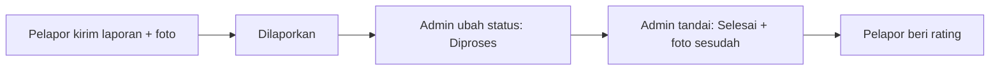

<div align="center">

# LaporFasilitas Kampus

**Lapor kerusakan fasilitas kampus dengan mudah, lalu pantau sampai selesai.**


<!-- Ganti dengan screenshot asli setelah halaman selesai -->


</div>

---

## Kenapa proyek ini dibuat?

Di kampus, AC yang tidak dingin, lampu mati, atau keran bocor sering dilaporkan lewat chat atau kertas. Akibatnya:

- laporan **tercecer atau terlupa**,
- pelapor **tidak tahu** apakah laporannya sudah ditangani,
- pengelola sarana prasarana **sulit merekap** kerusakan apa yang paling sering terjadi.

Masalah serupa juga dibahas di beberapa penelitian di Indonesia ([jurnal ITN](https://ejournal.itn.ac.id/jati/article/download/13698/7583/), [trouble ticket LAPAN](https://openlibrary.telkomuniversity.ac.id/pustaka/files/65015/abstraksi/aplikasi-trouble-ticket-di-lapan-bandung.pdf)).

**LaporFasilitas** memindahkan semuanya ke satu tempat: lapor, pantau, dan rekap.

## Cara kerjanya



Ada dua peran: **User** (mahasiswa/dosen/staf) dan **Admin** (petugas sarana prasarana).

## Fitur

### Untuk User
- Daftar dan masuk dengan akun sendiri
- Buat laporan lengkap dengan foto, kategori, dan lokasi
- Peringatan jika sudah ada laporan serupa yang sedang diproses
- Pantau status lewat timeline: Dilaporkan, Diproses, Selesai
- Edit atau batalkan laporan selama belum diproses
- Beri rating setelah perbaikan selesai

### Untuk Admin
- Dashboard: total laporan, grafik per status, per bulan, per kategori, dan lokasi paling sering rusak
- Kelola laporan: ubah status, prioritas, catatan, dan upload foto hasil perbaikan
- Penanda laporan yang terlambat ditangani
- Kelola data kategori dan lokasi
- **Import Excel** untuk data lokasi dan kategori (ada preview sebelum disimpan)
- **Export Excel dan PDF** untuk rekap laporan per periode

## Teknologi

| Bagian | Yang dipakai |
|---|---|
| Backend | PHP native (PDO), session |
| Database | MySQL |
| Tampilan | Tailwind CSS (CDN), JavaScript |
| Grafik | Chart.js |
| Ikon dan notifikasi | Lucide, SweetAlert2 |
| Excel | SheetJS |
| PDF | jsPDF + autoTable |

Semua library dimuat lewat CDN, jadi **tidak perlu Composer atau npm**.

## Keamanan

- Password disimpan dengan `password_hash()`
- Semua query memakai PDO prepared statement
- Output di-escape untuk mencegah XSS
- Form dilindungi token CSRF
- Upload foto dicek tipe dan ukurannya (JPG/PNG/WebP, maksimal 2 MB), lalu diberi nama acak
- Folder `uploads/` tidak boleh menjalankan file PHP

## Cara menjalankan

**Kebutuhan:** XAMPP atau Laragon dengan PHP 8.0 atau lebih baru dan MySQL.

1. **Download proyek**
   ```bash
   git clone https://github.com/RedzyIN/lapor-fasilitas-kampus.git
   ```
   Pindahkan foldernya ke `htdocs` (XAMPP) atau `www` (Laragon).

2. **Buat file koneksi**
   Salin `koneksi.example.php` menjadi `koneksi.php`, lalu sesuaikan user dan password MySQL kalau perlu.

3. **Import database**
   Buka phpMyAdmin, pilih tab **Import**, lalu pilih file `database.sql`.

4. **Buka di browser**
   ```
   http://localhost/lapor-fasilitas-kampus
   ```

### Akun demo

| Peran | Email | Password |
|---|---|---|
| Admin | `admin@kampus.test` | `admin123` |
| User | `mahasiswa@kampus.test` | `user123` |

> Akun ini hanya untuk demo. Ganti atau hapus sebelum dipakai sungguhan.

## Struktur folder

```
lapor-fasilitas-kampus/
├── index.php            # Landing page
├── login.php  register.php  logout.php
├── dashboard.php        # Ringkasan + grafik
├── laporan.php          # Daftar laporan
├── tambah.php  edit.php  detail.php  hapus.php
├── kategori.php  lokasi.php
├── import.php           # Import Excel
├── rekap.php            # Export Excel & PDF
├── init.php             # File pusat (session, koneksi, helper)
├── header.php  footer.php
├── koneksi.example.php  # Salin menjadi koneksi.php
├── includes/            # Fungsi bantu (auth, upload, umum)
├── assets/js/           # JavaScript per halaman
├── uploads/             # Foto laporan (tidak ikut di-commit)
├── docs/screenshots/    # Gambar untuk README
└── database.sql
```

## Progress

- [x] Rancangan database dan data contoh
- [x] Layout dasar (sidebar, navbar, notifikasi)
- [ ] Landing page, login, dan register
- [ ] Dashboard dan grafik
- [ ] Buat, lihat, edit, dan hapus laporan
- [ ] Timeline status dan upload foto
- [ ] Kelola kategori dan lokasi
- [ ] Import Excel
- [ ] Export Excel dan PDF
- [ ] Menghubungkan semua halaman ke database
- [ ] Tes akhir dan perapian tampilan

## Rencana ke depan

- Notifikasi saat status laporan berubah
- Peta denah lokasi kerusakan
- Mode gelap

## Lisensi

Dirilis dengan lisensi [MIT](LICENSE).

## Pembuat

Dibuat oleh **[RedzyIN](https://github.com/RedzyIN)**.
Proyek lain: [RedLine](https://github.com/RedzyIN/RedLine), platform koordinasi donor darah.
